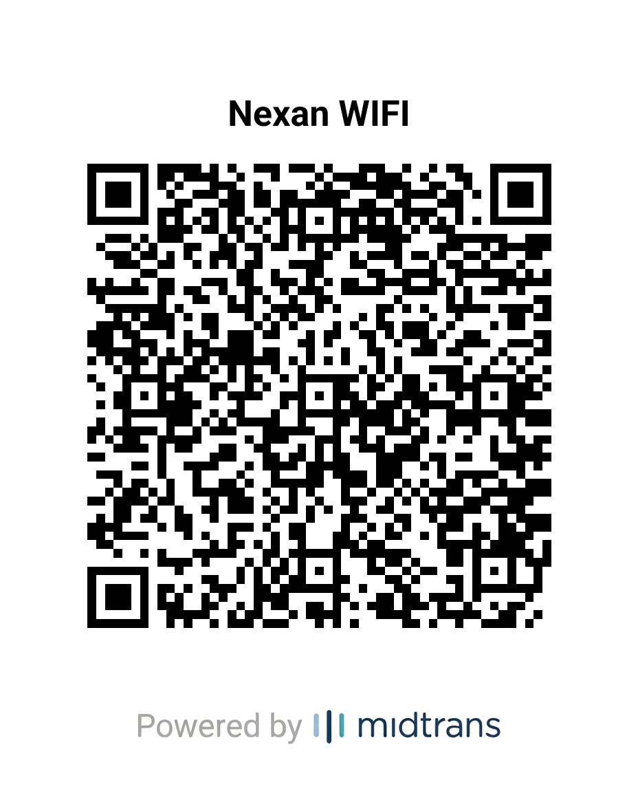

<!-- #ide cemerlang eki guistian -->
# Uptime Kuma ke WhatsApp

Aplikasi ini menerima notifikasi Uptime Kuma dan meneruskannya ke grup WhatsApp melalui NgirimWA. Kode webhook, antrean pesan, pemantauan, dan log disimpan dalam folder terpisah.

## Fitur

- Menerima status monitor `UP` dan `DOWN` melalui webhook.
- Memeriksa token webhook sebelum menerima pesan.
- Menyimpan pesan di antrean sebelum dikirim.
- Menahan pesan saat konfigurasi atau layanan pengiriman belum siap. Masa tunggu 10 menit dimulai saat worker pertama kali menandai pesan tertahan; setelah lewat 10 menit, pesan dicatat gagal dan dihapus pada worker berikutnya, meskipun layanan sudah pulih.
- Mengirim ulang status yang sama setelah jeda 10 menit sejak pesan terakhir diterima API, jika tidak ada pesan monitor itu yang masih di antrean.
- Mengirim satu pesan antrean tertua pada setiap eksekusi worker.
- Menghitung pesan berhasil, pesan gagal, dan status sama yang dilewati secara terpisah.
- Menampilkan status DNS, ping ICMP, konfigurasi, dan jumlah pesan di halaman utama.
- Membuat dan menyalin token webhook dari halaman utama.
- Menulis log ke folder `log/`.

## Alur singkat

1. Uptime Kuma mengirim data JSON dan header `X-Webhook-Token` ke `/webhook`.
2. Aplikasi memeriksa token dan memasukkan pesan ke antrean.
3. Cron menjalankan worker. Worker memeriksa konfigurasi, respons API NgirimWA, dan memastikan perangkat berstatus `connected`.
4. Jika siap, pesan dikirim. Jika belum siap, worker menahan pesan sampai layanan pulih sebelum batas 10 menit. Setelah batas lewat, worker menghapus pesan sebagai gagal.
5. Halaman utama membaca status dari snapshot worker. Browser tidak menghubungi API NgirimWA secara langsung.

Pesan berhasil berarti API NgirimWA menerima permintaan. Itu belum memastikan pesan sudah diterima atau dibaca di WhatsApp.

## URL webhook

Gunakan URL dengan path `/webhook`, tanpa ekstensi `.php`:

~~~text
https://domain-anda/webhook
~~~

Halaman utama menampilkan URL sesuai domain yang dibuka dan menyediakan tombol **Salin URL**. Web server perlu rewrite agar `/webhook` diarahkan ke handler aplikasi. Aturan rewrite untuk Apache dan Nginx ada pada panduan pemasangan masing-masing di bawah.

Token harus sama dengan `UPTIME_WEBHOOK_TOKEN` pada `.env`.

## Memasang notifikasi di Uptime Kuma

1. Pastikan `.env` aplikasi berisi `UPTIME_WEBHOOK_TOKEN` dan URL webhook dapat dibuka melalui HTTPS. Salin URL `/webhook` dari halaman utama aplikasi.
2. Di Uptime Kuma, buka **Settings → Notifications → Setup Notification** lalu pilih **Webhook**.
3. Isi **Post URL** dengan URL yang disalin, misalnya:

~~~text
https://domain-anda/webhook
~~~

4. Atur **HTTP Method** ke **POST**.
5. Pilih **Request Body: JSON (`application/json`)**. Biarkan format JSON bawaan Uptime Kuma; jangan pilih `form-data` atau `custom` karena handler menerima payload JSON standar.
6. Aktifkan **Additional Headers**, lalu masukkan JSON berikut. Ganti nilainya dengan token yang sama persis dengan `UPTIME_WEBHOOK_TOKEN` di `.env`:

   ~~~json
   {
     "X-Webhook-Token": "token-yang-ada-di-file-env"
   }
   ~~~

7. Simpan notifikasi, lalu gunakan tombol **Test**. Aplikasi menerima tes sebagai pesan uji dengan nama dan status acak. Respons berhasil dari Uptime Kuma berarti webhook diterima oleh aplikasi; pengiriman WhatsApp dilakukan worker cron setelah itu.
8. Buka pengaturan setiap monitor yang ingin diberi notifikasi, pilih notifikasi Webhook yang baru dibuat, lalu simpan perubahan monitor.

Jika tes ditolak, pastikan token header sama dengan `.env`, metode tetap **POST**, body menggunakan JSON, dan URL rewrite `/webhook` aktif. Jika webhook diterima tetapi pesan belum sampai, periksa status cron dan file `log/cron-run.log` serta `log/send-failure.log`.

## Konfigurasi

Salin `.env.example` menjadi `.env`, lalu isi API key, group ID, URL API, token, dan alamat website status. `NGIRIMWA_BASE_URL` perlu diisi agar worker dapat mengirim pesan. Nilai rahasia tidak ditampilkan pada halaman utama.

Variabel utama:

~~~dotenv
NGIRIMWA_API_KEY=
NGIRIMWA_GROUP_ID=
NGIRIMWA_BASE_URL=https://dash.ngirimwa.com/api/v1
UPTIME_MESSAGE_SIGNATURE=Server Monitoring
UPTIME_STATUS_WEBSITE=https://status.example.com
UPTIME_WEBHOOK_TOKEN=
~~~

`UPTIME_STATUS_WEBSITE` dipakai pada isi pesan dan sebagai target ping. Jika `.env.example` atau file `.env` lama masih memiliki `UPTIME_KUMA_URL`, aplikasi tidak membacanya; gunakan `UPTIME_STATUS_WEBSITE` untuk alamat yang ditampilkan dan diuji. Token webhook harus diatur sebelum webhook dapat menerima pesan. Tanpa token, handler menolak request; pesan tidak masuk antrean.

## Antrean dan jumlah pesan

- **Berhasil**: pesan yang diterima API NgirimWA.
- **Gagal**: pesan antrean yang gagal diproses atau kedaluwarsa setelah tertahan lebih dari 10 menit. Request webhook yang ditolak saat validasi tidak masuk hitungan ini.
- **Dilewati · status sama**: webhook dengan status sama dalam jeda 10 menit. Angka ini tidak menambah jumlah pesan gagal.
- Jika ada pesan untuk monitor yang masih di antrean, webhook berikutnya untuk monitor itu dilewati agar tidak membuat antrean ganda. Kejadian ini tidak masuk hitungan status sama.
- Pesan uji Uptime Kuma dikenali dari payload uji, lalu memakai nama dan status angka acak 10 digit. Kata seperti `latest` pada pesan status normal tidak dianggap sebagai uji.

## Monitor

- DNS diuji dengan kueri UDP ke resolver yang terdeteksi dari konfigurasi DNS server.
- NgirimWA dan `UPTIME_STATUS_WEBSITE` diuji dengan ICMP echo ping menggunakan perintah `ping`, bukan HTTP/HTTPS.
- Ping domain berjalan paling banyak sekali per menit. Snapshot diperbarui setiap 5 detik oleh worker monitor.
- API key, token, dan group ID hanya ditampilkan sebagai status terisi atau belum.

Binary `ping` harus tersedia dan diizinkan pada server. Cron untuk worker monitor dijalankan sekali per menit dengan opsi `--loop`; jangan jadwalkan perintah itu setiap 5 detik karena loop sudah berjalan selama sekitar satu menit.

## File utama

~~~text
api/uptime.php          Handler webhook dan antrean
api/send-queue.php      Worker pengiriman pesan
api/live-monitor.php    Worker monitor jaringan
api/live-status.php     Data monitor untuk halaman utama
public/index.php        Halaman utama
public/api/             Wrapper publik untuk endpoint aplikasi
log/                    Log sistem, pengiriman, dan cron
~~~

Document root web server diarahkan ke folder `public/`. Dengan begitu, `.env`, `api/`, dan `log/` berada di luar akses web langsung. Jalankan cron dengan akun Unix yang sama seperti PHP-FPM agar keduanya dapat memperbarui antrean dan log. Jika akun berbeda, atur hak tulis melalui grup bersama pada folder `api/` dan `log/`; hindari memberi izin akses umum seperti `777`.

## Pemasangan di aaPanel

1. Unggah project ke folder website, misalnya `/www/wwwroot/domain-anda`.
2. Atur document root website ke `/www/wwwroot/domain-anda/public`.
3. Pilih versi PHP di pengaturan website aaPanel. Contoh panduan ini memakai PHP 8.4.
4. Salin dan isi `.env`:

   ~~~bash
   cd /www/wwwroot/domain-anda
   cp .env.example .env
   ~~~

5. Jalankan task cron dengan akun yang sama seperti PHP-FPM/website. Jika memakai akun berbeda, pastikan grup bersama memiliki hak tulis ke `api/` dan `log/`.
6. Periksa direktori PHP aaPanel dan versinya:

   ~~~bash
   ls -d /www/server/php/*/
   /www/server/php/84/bin/php -v
   ~~~

   Jika menggunakan versi lain, ganti `84` sesuai folder PHP yang tersedia. `php -v` memeriksa PHP CLI default, sedangkan `/www/server/php/84/bin/php -v` memeriksa PHP 8.4 secara langsung.

7. Buat dua task melalui **Cron → Add Task → Shell Script**, interval satu menit:

   ~~~bash
   /www/server/php/84/bin/php /www/wwwroot/domain-anda/api/send-queue.php >> /www/wwwroot/domain-anda/log/cron-run.log 2>&1
   ~~~

   ~~~bash
   /www/server/php/84/bin/php /www/wwwroot/domain-anda/api/live-monitor.php --loop >> /www/wwwroot/domain-anda/log/cron-run.log 2>&1
   ~~~

8. Atur rewrite sesuai web server yang dipilih:
   - Apache: gunakan `public/.htaccess` dan pastikan `mod_rewrite` aktif.
   - Nginx: tambahkan aturan rewrite pada konfigurasi domain seperti contoh di bagian **Pemasangan Linux dengan Nginx**.

## Pemasangan Linux dengan Apache

1. Pasang PHP, ekstensi cURL, dan Apache dengan PHP-FPM atau modul PHP.
2. Tempatkan project di folder website dan arahkan `DocumentRoot` ke folder `public/`.
3. Aktifkan `mod_rewrite` dan izinkan aturan `.htaccess` untuk website. File `public/.htaccess` sudah berisi rewrite `/webhook`.
4. Salin `.env.example` menjadi `.env`, lalu isi konfigurasi. Jalankan cron dengan akun yang sama seperti PHP-FPM/website; jika berbeda, atur grup bersama agar dapat menulis ke `api/` serta `log/`.
5. Tambahkan dua cron berikut dengan interval satu menit. Sesuaikan lokasi PHP dan folder project:

   ~~~cron
   * * * * * /usr/bin/php /var/www/domain-anda/api/send-queue.php >> /var/www/domain-anda/log/cron-run.log 2>&1
   * * * * * /usr/bin/php /var/www/domain-anda/api/live-monitor.php --loop >> /var/www/domain-anda/log/cron-run.log 2>&1
   ~~~

6. Pastikan URL `https://domain-anda/webhook` dapat dibuka melalui rewrite. HTTPS diperlukan untuk melindungi token saat dikirim.

## Pemasangan Linux dengan Nginx

1. Pasang PHP-FPM, ekstensi cURL, dan Nginx.
2. Tempatkan project di folder website dan atur `root` Nginx ke folder `public/`. Gunakan konfigurasi PHP-FPM yang sesuai dengan versi PHP server.
3. Salin `.env.example` menjadi `.env`, lalu isi konfigurasi. Jalankan cron dengan akun yang sama seperti PHP-FPM; jika berbeda, atur grup bersama agar dapat menulis ke `api/` serta `log/`.
4. Tambahkan aturan ini di dalam blok `server { ... }` domain. Pastikan konfigurasi PHP-FPM yang sudah ada tetap menangani `/api/uptime.php`:

   ~~~nginx
   rewrite ^/webhook/?$ /api/uptime.php last;
   ~~~

5. Uji konfigurasi dan muat ulang Nginx:

   ~~~bash
   nginx -t
   systemctl reload nginx
   ~~~

6. Tambahkan dua cron dengan interval satu menit. Sesuaikan PHP CLI dan lokasi project:

   ~~~cron
   * * * * * /usr/bin/php /var/www/domain-anda/api/send-queue.php >> /var/www/domain-anda/log/cron-run.log 2>&1
   * * * * * /usr/bin/php /var/www/domain-anda/api/live-monitor.php --loop >> /var/www/domain-anda/log/cron-run.log 2>&1
   ~~~

## Log

- `log/send-success.log`: pesan yang diterima API NgirimWA.
- `log/send-failure.log`: pesan yang gagal atau kedaluwarsa.
- `log/system.log`: aktivitas umum, termasuk status sama yang dilewati.
- `log/cron-run.log`: aktivitas cron dan worker.
- `log/php-error.log`: error PHP yang tidak ditampilkan di browser.

Angka pada monitor halaman utama tersimpan di `log/delivery-metrics.json`. Folder `log/` tidak dilacak Git. Terapkan rotasi log sesuai pengaturan server.

## Keamanan

- Gunakan HTTPS dan token webhook yang sulit ditebak.
- Jangan unggah `.env`, API key, token, atau log berisi data sensitif ke GitHub.
- Pastikan document root hanya mengarah ke `public/`.
- Laporkan masalah keamanan secara privat melalui petunjuk di [SECURITY.md](SECURITY.md).

## Kontribusi

Perbaikan dan usulan dapat dikirim melalui [GitHub Issues](https://github.com/ekiguistian/webhook_uptimekuma-sendwa/issues) atau [Pull Requests](https://github.com/ekiguistian/webhook_uptimekuma-sendwa/pulls). Lihat [CONTRIBUTING.md](CONTRIBUTING.md).

## Dukungan anda berarti bagi saya untuk mengembangkan dan menemukan lebih banyak inspirasi.

[Traktir Eki Segelas Kopi](https://app.midtrans.com/payment-links/b45ec2c9-80f7-4dd8-b2e9-e18d430d192e-7l5NTR4t)

Tautan ini juga ada di `.github/FUNDING.yml`.
